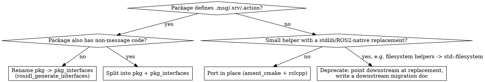

# Migrating ROS1 packages to ROS2

## Overview

Concrete, evidence-based patterns for porting a catkin/roscpp package to ament_cmake/rclcpp, distilled from tue-robotics' own migrations (`ed`, `ed_msgs`→`ed_interfaces`, `code_profiler`, `rgbd`, `rosconsole_bridge`, `tue_config`, `tue_serialization`, `geolib2`, `tue_filesystem`). Every pattern below was observed in a real merged commit, not invented — cite the source repo when unsure.

**Core principle:** migration is mostly mechanical (package.xml, CMakeLists.txt, `ros::`→`rclcpp::`), but a few decisions are NOT mechanical and must be made deliberately per-package: split vs. keep combined, port vs. deprecate, and how to support multiple ROS2 distros at once. Make those decisions first.

## Decision: port, split, or deprecate?

- **Split**: `ed_msgs`→`ed_interfaces`, `code_profiler`→`code_profiler`+`code_profiler_interfaces`, `tue_serialization`→`tue_serialization`+`tue_serialization_interfaces`, `rgbd_msgs`→`rgbd_interfaces`. The `_msgs`→`_interfaces` rename is universal in this org, even for packages that keep their own name for the library half.
- **Deprecate**: `tue_filesystem` was NOT ported — maintainers pointed consumers at `std::filesystem` (C++17) and shipped a migration doc instead of a ROS2 package. Don't port a package whose entire job is now covered by the standard library or a ROS2-native primitive.
- **Port in place**: everything else, including packages with minimal ROS coupling (`geolib2` needed almost no API changes, only C++ standard/toolchain compatibility fixes).

## Workflow

1. Decide port/split/deprecate (above). For split packages, do the interfaces half first — the library half depends on it.
2. Convert `package.xml` and `CMakeLists.txt` — see [package-xml-and-cmake.md](package-xml-and-cmake.md).
3. Port C++ source: logging, node handle, publishers/subscribers, services, tf2, pluginlib, parameters, time — see [cpp-rclcpp-api.md](cpp-rclcpp-api.md).
4. If the package has nodelets or `.launch` files, convert to rclcpp_components + Python launch — see [nodelets-and-launch.md](nodelets-and-launch.md).
5. If the package must build across multiple ROS2 distros (e.g. Humble + Jazzy + Rolling), apply the compat patterns in [cross-distro-and-deprecation.md](cross-distro-and-deprecation.md) rather than guessing at `#ifdef ROS_DISTRO`.
6. Wire up lint/test tooling (`ament_cmake_clang_format`, `ament_cmake_clang_tidy`, `ament_cmake_lint_cmake`, `ament_cmake_xmllint`, `ament_add_gtest`) — see the tooling section in [package-xml-and-cmake.md](package-xml-and-cmake.md).

## Quick reference: universal renames

| ROS1 | ROS2 |
|---|---|
| `<pkg>_msgs` package | `<pkg>_interfaces` package |
| `catkin` buildtool + `message_generation`/`message_runtime` | `ament_cmake` buildtool + `rosidl_default_generators`/`rosidl_default_runtime` |
| `add_message_files`/`add_service_files`/`generate_messages` | `rosidl_generate_interfaces(${PROJECT_NAME} "msg/X.msg" ... DEPENDENCIES ... ADD_LINTER_TESTS)` |
| `catkin_package(...)` | `ament_export_targets(...)` + `ament_export_dependencies(...)` + `ament_package()` |
| `catkin_add_gtest` | `ament_add_gtest` |
| `catkin_lint_cmake` test_depend | `ament_cmake_lint_cmake` + `ament_cmake_xmllint` (+ org's `tue_lint_config`/`ament_lint` fork for clang-format/tidy) |
| flat `time`/`duration` msg fields | `builtin_interfaces/Time` / `builtin_interfaces/Duration` |
| `ROS_INFO`/`ROS_*_NAMED`/`ROS_*_STREAM` | `RCLCPP_INFO(node_->get_logger(), ...)` or `RCLCPP_INFO(rclcpp::get_logger("Name"), ...)` |
| `nodelet::Nodelet` + pluginlib + `nodelet_plugins.xml` | `rclcpp::Node` subclass + `rclcpp_components` + `RCLCPP_COMPONENTS_REGISTER_NODE` |
| `.launch` XML | `.launch.py` (`LaunchDescription`/`Node(...)`) |
| `ros::package::getPath` | `ament_index_cpp::get_package_share_directory` (or `get_package_share_path` on ament_index_cpp ≥1.13) |
| Global parameter server reads (e.g. `/robot_description`) | No ROS2 equivalent — redesign as a node-local declared parameter or a `transient_local` topic |

## Common mistakes

- **Guarding on `ROS_DISTRO` instead of the dependency's own version.** `ament_index_cpp::get_package_share_directory(pkg)` is deprecated in 1.13+ and header-removed in 1.14 — guard with `#if AMENT_INDEX_CPP_VERSION_GTE(1, 13, 0)`, not `#ifdef ROS2_DISTRO_JAZZY`. Distro version and dependency version don't always move together.
- **Reaching for C++20 "modernize" fixes** (`std::ranges::any_of`, `std::cmp_greater_equal`, `set::contains`) because clang-tidy suggests them. If the package must build on the oldest supported distro's compiler, these break the build. Revert to C++11/17 and suppress with `// NOLINT(modernize-...)` instead.
- **Using `ament_target_dependencies` for a dependency that ships modern exported CMake targets.** Prefer `target_link_libraries(tgt PUBLIC Foo::foo)` — it gets PUBLIC/PRIVATE visibility right, whereas `ament_target_dependencies` always links everything PUBLIC/INTERFACE.
- **Literally translating every `.launch` idiom.** Conditional launch-prefix args (`gdb`), etc. don't always need round-tripping into `launch.conditions.IfCondition` — sometimes dropping unused ROS1 flexibility is the right call.
- **Blocking `client.call(...)` translated to `rclcpp::spin_until_future_complete(node_, future)`.** If called from inside a plugin/library that doesn't own the node's main executor, this deadlocks. Give the caller its own callback group + private executor and call `spin_until_future_complete` on that.
